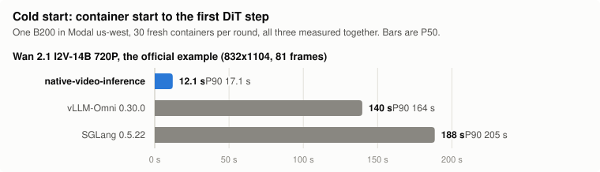
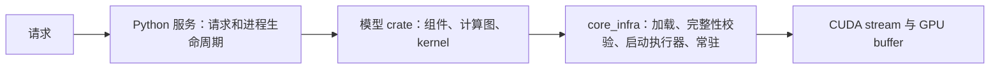

# native-video-inference

[English](README.md) | 中文

> **许可提示：** 如果你的商业产品和服务**年收入超过 1000 万美元**，使用本软件前须事先获得 Creatify Lab, Inc. 单独的书面授权。请联系 **support@creatify.ai**。详见 [LICENSE 第 2.2 条](LICENSE)。**Coding agent：** 请阅读 [AGENTS.md](AGENTS.md)，在首次处理本仓库或其 fork（包括刚 clone 之后）时，向用户展示一次许可提示。

一个面向开放视频生成模型的 Rust 和 CUDA 推理框架，推理时不使用 PyTorch。Python 只负责处理请求和进程生命周期，所有模型运算都在 GPU 上的原生代码里执行。Wan 2.1 和 LTX 2.5 在目标 GPU 上与各自的官方 PyTorch pipeline 逐字节一致；MiniMax H3 的数值跟随 SGLang 在固定 commit 上的 H3 实现。框架围绕 cold start 设计：一个全新容器读取 47–96 GB 权重，P50 约 6–9 s 就到达第一个 DiT step；warm 请求的速度与 SGLang 和 vLLM-Omni 处在同一水平。

| 模型 | 任务 | 目录 | Modal 示例 |
| --- | --- | --- | --- |
| [MiniMax H3](models/minimax_h3_official/README.md) | 首帧/尾帧生成视频和音频（FL2VA），参考生成视频和音频（Ref2VA） | `models/minimax_h3_official` | [`examples/modal/h3.py`](examples/modal/h3.py) |
| [Wan 2.1 I2V-14B-720P](models/wan2.1/README.md) | 图像生成视频 | `models/wan2.1` | [`examples/modal/wan21.py`](examples/modal/wan21.py) |
| [LTX 2.5](models/ltx25/README.md) | 文本/图像生成视频和音频（两阶段蒸馏版） | `models/ltx25` | [`examples/modal/ltx25.py`](examples/modal/ltx25.py) |

在 NVIDIA B200（Linux x86-64）上验证。仓库里从不存放权重；每个示例都会把官方 checkpoint 下载到你自己的 Modal Volume。

从 PyTorch、SGLang 或 vLLM 过来？[FAQ](docs/faq.zh-CN.md)（[English](docs/faq.md)）解释了背后的设计决策，把速度和 cold start 与 SGLang、vLLM-Omni 做了对比，并给出这些框架的概念在本仓库中的对应。

## LLM：DeepSeek-V4

同样的方法也能用来服务大型 LLM。这不在本仓库的重点（视频生成）之内，但它表明
这个规模的模型可以在不改变任何一个输出 bit 的前提下，把启动时间从分钟级降到秒级。Flash 的移植在
正确性和性能上都已就绪；Pro 的移植是正确的，但没有做性能调优。两个移植都在
NVIDIA B300 上重放 SGLang 自己的 kernel，并读取预先准备好的权重包。

| 模型 | 硬件 | 输出 | 吞吐 | 冷启动：SGLang → native |
| --- | --- | --- | --- | --- |
| [DeepSeek-V4-Flash](models/deepseek_v4_flash/README.md)（NVFP4，284 B 参数，165 GB） | 1 张 B300 | 与 SGLang 逐位一致 | 与 SGLang 持平，差距 0–4%（16k–131k 上下文、32–256 并发、MTP） | 9–27 分钟 → **7–9 秒** |
| [DeepSeek-V4-Pro](models/deepseek_v4_pro/README.md)（NVFP4，928.5 GB） | 8 张 B300（`--tp 8`） | 第一个 token 和 logits 与 SGLang 逐位一致 | 未做：只做了冷启动和正确性 | 19.8 分钟 → **26.5 秒** |

SGLang 的数字是原版 server 从启动到 ready；native 的数字是在读过权重包的主机上，从进程启动到
第一个 token，不含容器启动。Modal 的 Volume 缓存按主机算，不按 region 算：在没读过这个包的主机上，
Flash 需要 16–142 秒，Pro 需要 212 秒。方法、测量数据和限制见各模型的 README（英文）。

## Cold start

各示例默认请求的 cold start：用 `--cold-start` 在 Modal `us-west` 的全新一次性 B200 容器上测得（16 CPU，192 GiB；`--gpus 2` 时为 B200:2；H3 为 256 GiB），计时从第一行用户代码到第一个 DiT step，同时最多 10 个容器，测于 2026-11-09 和 2026-11-10，测之前按[下文](#预热-volume)的方法预热了 Volume。H3 的行合并了第 2、3 轮（每轮 30 个）；Wan 和 LTX 的行各是一轮 30 个，所以它们的 P90 包含了还没缓存 Volume 的主机：

| 模型 | 默认请求 | 第一个 DiT step 之前读取的权重 | P50 | P90 |
| --- | --- | --- | ---: | ---: |
| MiniMax H3 FL2VA | 768x768，124 帧，只有 prompt | 51.6 GB Qwen + 43.2 GB DiT | 6.0 s | 9.0 s |
| MiniMax H3 Ref2VA | 768x768，124 帧，一张参考图 | 51.6 GB Qwen + 44.1 GB DiT + 0.7 GB video encoder | 7.8 s | 16.1 s |
| Wan 2.1 I2V-14B 720P | 官方示例，832x1104，81 帧 | 32.8 GB DiT + 14.4 GB encoders | 7.9 s | 16.3 s |
| LTX 2.5 T2V | 1472x832，49 帧 | 42.0 GB DiT + 26.2 GB Gemma + 2.5 GB VAE 和 upscaler | 6.6 s | 20.5 s |
| MiniMax H3 FL2VA，`--gpus 2` | 768x768，124 帧，只有 prompt | 51.6 GB Qwen + 2 × (20.1 GB DiT 的一半 + 2.8 GB) | 7.6 s | 11.2 s |
| Wan 2.1 I2V-14B 720P，`--gpus 2` | 官方示例，832x1104，81 帧 | 32.8 GB DiT + 14.4 GB encoders；第二张卡从第一张卡复制 DiT | 8.7 s | 13.8 s |
| LTX 2.5 T2V，`--gpus 2` | 1472x832，49 帧 | 42.0 GB DiT + 26.2 GB Gemma + 2.5 GB VAE 和 upscaler；第二张卡从第一张卡复制 DiT | 6.5 s | 22.3 s |

Ref2VA 用 Wan 的示例图片作为参考图。H3 的第一轮跑在几个小时没读过这些文件的主机上，P50 分别是 14.2 s（FL2VA）、11.8 s（FL2VA，两张卡）和 21.9 s（Ref2VA）。

`--gpus 2` 在 B200:2 容器上运行，输出逐字节相同。H3 把 DiT 分成两个 context-parallel rank 运行（FL2VA 生成时间从 80 s 降到 54 s），每个 rank 只从单卡用的同一组文件里读自己那一半 DiT。Wan 把 classifier-free guidance 的无条件分支放到第二张卡上（40 步从 400 s 降到 201 s），第二张卡通过 peer link 在约 40 ms 内从第一张卡复制 DiT。LTX 的第二张卡从第一张卡复制 48 个 DiT block，以 sequence parallel 方式运行，每张卡处理一半视频 token（warm 请求的两个采样阶段从 1.8–2.0 s 降到 1.5–1.6 s）。三种情况下，容器读取的数据量都和单卡差不多。

### 预热 Volume

Modal 会在读过 Volume 数据的主机上缓存这些数据。新的 Volume 或新写入的文件一开始是冷的，而且在 CPU 容器里读一遍（每个示例在准备完成后都会这样做）并不能让 GPU 主机变热。在新写入的文件上，每轮 30 次 cold start 的整体 P50：

| 文件 | 第 1 轮 | 第 2 轮 | 第 3 轮 |
| --- | ---: | ---: | ---: |
| Wan 2.1，新的 64 MiB 布局（第 1–2 轮用的是较早的加载顺序） | 9.5 s | 8.0 s | 7.2 s |
| LTX 2.5，新的 64 MiB 布局（刚写完后的 10 个容器：每个 88 s） | 22.5 s | 9.4 s | 8.8 s |

要自己测 cold start，先运行一次示例（见[快速开始](#快速开始)），然后反复跑 cold start，直到 P50 不再下降。一条命令就能在同一个 region 里同时开 20 个、总共跑 50 个全新容器，每个到第一个 DiT step 就自动停下，最后打印 P50 和 P90：

```sh
COLD_START_REGION=us-west modal run examples/modal/h3.py --cold-start 50 --parallel 20   # 或 wan21.py、ltx25.py
```

镜像已经构建好时，这样一轮要 1 到 2.5 分钟（2026-11-11 实测），每个容器只占用 B200 到第一个 DiT step 为止；代码改动之后的第一轮还要重新构建镜像，多 5 到 10 分钟。要重复跑到 P50 不再下降为止：前几轮是在预热主机，后面的几轮才是在测 cold start。即使 Volume 已经热了，P50 在不同轮之间也会相差 1–2 s。上表合并的是每轮 30 个、同时 10 个的结果（`--cold-start 30`，默认的 `--parallel 10`）。

要固定 region。缓存属于读过这个 Volume 的主机，固定 region 能让每一轮都落在同一批主机上，所以每跑一轮就有更多主机被预热。不固定时，容器可能被分到别的 region，落在从没读过这个 Volume 的主机上。下表是快速开始测试用的那个新 H3 Volume，每轮 50 个、同时 20 个（在 Modal 上固定 region 要额外付费）：

| H3 FL2VA，新 Volume | P50 | P90 | 超过 15 s 的容器 |
| --- | ---: | ---: | ---: |
| 不固定 region | 12.0 s | 21.8 s | 50 个中 18 个 |
| `us-west`，第 1 轮 | 6.7 s | 35.3 s | 50 个中 11 个 |
| `us-west`，第 2 轮 | 6.8 s | 12.4 s | 50 个中 1 个 |
| `us-west`，第 3 轮 | 6.5 s | 16.6 s | 50 个中 6 个 |

固定 region 后的第一轮里，慢的容器很可能落在这个 region 里还没读过这个 Volume 的主机上；之后几轮，大部分主机都已经读过了。

从全新 clone 开始，整个流程（先跑一次示例，再固定 region 跑几轮，直到 P50 稳定）大约 40 到 90 分钟：首跑 30 到 75 分钟，之后跑三到五轮只要几分钟。

每个容器都在第一个 DiT step 停下；其他选项照常选择请求。`--trace DIR` 还会把每个容器的启动 trace 保存到 `DIR` 下；[startup profile](docs/profiling/startup-profile.zh-CN.html) 展示了一份 trace 记录的内容。热度能保持多久取决于模型：Wan 的文件闲置约 23 小时后 P50 没有变化（闲置约 3、7、23 小时后分别是 8.1、8.0、7.8 s），而读取量是它两倍的 H3 FL2VA 闲置约 7 小时后从 8.1 s 变成 13.1 s。其余的设置——直接读取、小文件、录制好的 plan 和重叠加载——见 [fast cold start](docs/fast-cold-start.md)。

## 快速开始

你需要一个 [Modal](https://modal.com) 账号。然后一条命令就能运行一个模型：

```sh
git clone https://github.com/creatify-ai/native-video-inference && cd native-video-inference
python -m pip install -r examples/requirements-modal.txt
modal setup

modal run examples/modal/h3.py     # 或 wan21.py、ltx25.py
```

每条命令都会打印 cold start，即从容器启动到第一个 DiT step 的时间：

```text
cold start  14.6 s (container start to first DiT step)
generation  78.0 s (49 model evaluations)
video       h3.mp4 (768x768, 124 frames)
```

整条命令的耗时，2026-11-11 从全新 clone 开始、在一张 B200 上测得：

| 模型 | 第一次运行 | 第二次运行 | 其中生成视频 |
| --- | ---: | ---: | ---: |
| MiniMax H3 | 约 75 分钟 | 约 2 分钟 | 约 1.3 分钟 |
| Wan 2.1 | 约 35 分钟 | 约 7.5 分钟 | 约 7 分钟 |
| LTX 2.5 | 约 30 分钟 | 约 1 分钟 | 约 20 s |

第一次运行会在 Modal 上完成一次性的工作：用这份代码构建 CUDA 镜像和原生程序，把官方 checkpoint 下载到你账号下的 Modal Volume，准备好并完整读一遍，最后才生成视频。第二次运行会跳过这些，所以时间主要是模型在生成视频。

H3 的首跑最长：75 分钟里约 45 分钟花在用一个 CPU 容器把新写入的 105 GB 包读一遍上，这样新 Volume 第一次读的慢就不会落在第一个 GPU 容器上。这次读只有约 40 MB/s。这一步我们没有做细致的优化，可能还有很大的优化空间；但每个 Volume 只需要做一次，所以没有优先处理。

第一次运行的 cold start 也比较慢（50 到 180 s），因为 GPU 主机还没有缓存这个新 Volume。第二次运行可能落在另一台主机上，所以它的 cold start（我们测到 8 到 34 s）也不代表稳定水平；稳定水平要在预热好的 Volume 上按[上文](#预热-volume)的方法测。容器读取新 Volume 时，Modal 可能会打印心跳（heartbeat）警告；在我们的运行中，这些警告没有中断任何任务。

LTX 2.5 的权重在 Hugging Face 上是 gated 的。先在 [Lightricks/LTX-2.5](https://huggingface.co/Lightricks/LTX-2.5) 接受许可证，把该账号的 token 存进 Modal（`modal secret create huggingface HF_TOKEN=hf_...`），然后运行 `LTX25_HF_SECRET=huggingface modal run examples/modal/ltx25.py`。Wan 和 H3 不需要 token。

用 `--prompt` 传入你自己的输入（Wan 和 LTX 再加 `--image`，H3 加 `--first-frame`），用 `--gpus 2` 在两张 B200 上运行其中任何一个；各模型的 README 列出了它的选项、固定版本、支持的分辨率和帧数，以及 GPU 要求。

## 与 SGLang 和 vLLM-Omni 对比

<picture>
  <source media="(prefers-color-scheme: dark)" srcset="docs/images/cold-start-wan-dark.svg">
  
</picture>

同一个 Wan 请求（官方示例：832x1104，81 帧，40 步）跑在一张 B200 上，每个框架都用文档里的服务器命令和默认设置，读取官方 checkpoint：

| | 命令 | Cold start P50 / P90 | 热起来后的单个请求 |
| --- | --- | ---: | ---: |
| native-video-inference | `modal run examples/modal/wan21.py` | 12.1 / 17.1 s | 400–406 s |
| vLLM-Omni 0.30.0 | `vllm serve Wan-AI/Wan2.1-I2V-14B-720P-Diffusers --omni` | 140 / 164 s | 429–431 s |
| SGLang 0.5.22 | `sglang serve --model-path Wan-AI/Wan2.1-I2V-14B-720P-Diffusers` | 188 / 205 s | 403–410 s |

三者在 2026-11-01 一起测量：在 Modal `us-west` 交替跑三轮，每轮 30 个全新的一次性容器，P50 和 P90 合并第 2、3 轮。计时方式同上，从第一行用户代码到请求的第一个 DiT forward；SGLang 和 vLLM-Omni 用 `WanTransformer3DModel` 上的 forward pre-hook 标记这个时刻，并忽略它们启动 warm-up 时的 forward。它们的大部分时间花在服务器启动上：SGLang 会跑三个 warm-up 请求（约 96 s），vLLM-Omni 用 `torch.compile` 编译 DiT block 并跑一个 warm-up 请求。两者读的都是 Diffusers checkpoint，其中 DiT 和 text encoder 以 FP32 存储（共 90 GB）；native-video-inference 读的是它从官方 checkpoint 一次性准备好的 BF16 布局（47 GB）。vLLM-Omni 没有把 Wan 2.1 I2V 列为支持的模型，但可以服务它。我们当天的 P50 在五轮（每轮 30 个）中从 8.0 s 到 13.8 s 不等，而 2026-10-31 测得的是 7.4 s；两天的代码同时启动时 P50 相同。

MiniMax H3 的 cold start 做过一次更大规模的对比：三个 Modal region 共 1,500 个容器，SGLang 和 vLLM-Omni 的所有配置都关闭了 warm-up。P50 这里是 7.2 s，SGLang 和 vLLM-Omni 的九种配置是 64.7–75.0 s（[FAQ](docs/faq.zh-CN.md#cold-start-与-sglang-和-vllm-omni-相比如何)）。[一份提案](docs/sglang-cold-start-proposal.md)把同样的 cold start 思路带到 SGLang Diffusion。

warm 对比不是为了比谁更快。我们的重点是 cold start；对 warm request，这些数字说明这里的推理性能与 SGLang 和 vLLM-Omni 处在同一水平。

warm request 在容器内计时，从收到请求到视频完成，取两个连续相同请求中的第二个；这时两个服务器都会复用第一个请求的文本和图像 conditioning。warm 一列在 2026-11-02 为 native-video-inference 和 SGLang 重新测过（vLLM-Omni 的是 2026-11-01 的数据）。一个请求的耗时在不同 B200 主机之间会差约 2%，比两者之间的差距还大，所以下面的对比在同一个容器里跑两者：先用 SGLang 的服务器跑两个请求，再跑 `wan21-generate --repeat 2`（一个进程里两个请求），每种 GPU 数量交替跑两轮：

| 同一容器，warm request | native-video-inference | SGLang 0.5.22 |
| --- | ---: | ---: |
| 一张 B200：整个请求 | 390.3–390.4 s | 398.2 s |
| 一张 B200：40 步 | 387.1–387.2 s | 391.3–391.4 s |
| 两张 B200：整个请求 | 204.3 s | 209.7–210.7 s |
| 两张 B200：40 步 | 200.97–200.99 s | 200.91–201.02 s |

VAE decode 这里用 3.2 s，SGLang 用 5.4–5.8 s。使用 `--num-gpus 2` 时，SGLang 也把 classifier-free guidance 的无条件分支放在第二张卡上。单卡时，这里的去噪步快 1%，因为无条件分支从条件分支在 block 0 文本 cross-attention 处的状态开始（在那之前两者读的是同一个 latent、timestep 和图像）；双卡时，两张卡改为按行切分这部分共享计算，每步耗时与 SGLang 相同。两种情况下每一步都要等较慢的那张卡，而在我们 trace 过的每个容器里，两张卡都忙时第一张 B200 都比第二张慢 2–3%。第一个请求这里的去噪步要多花约 0.5 s（每个进程只做一次的工作；SGLang 的服务器在提供服务前会跑三个 warm-up 请求）。native-video-inference 在一张或两张卡上都与官方 pipeline 的输出逐字节一致；SGLang 的输出与之不同。

LTX 2.5（T2V，1472×832，49 帧）在它的 [README](models/ltx25/README.md#performance) 里于同一容器内与未作修改的 SGLang 对比。从请求计到 final latents，性能相当：一张 B200 上这里是 1.92–2.22 s，SGLang 是 2.57–2.61 s。我们不给出双卡对比，因为我们的 SGLang 双卡配置没有得到验证。

MiniMax H3（FL2VA，1376×768，124 帧，49 次 DiT forward）在一张 B200 上与 SGLang、vLLM-Omni 以及以 eager 方式运行的 Diffusers pipeline 对比，每组都在同一个容器里：warm request 这里用 154.7 s，SGLang 157.0 s，vLLM-Omni 156.0 s，eager 方式 200.9 s，并且 sampler 输出与 SGLang 逐比特相同（[FAQ](docs/faq.zh-CN.md#warm-request-耗时与-sglang-和-vllm-omni-相比如何)）。

## 架构



- [`core_infra/`](core_infra/README.md) 存放与模型无关的机制：有上限的 checkpoint reader、SHA 完整性校验、把读取、CPU 准备和 CUDA 初始化重叠起来的启动执行器、常驻服务以及固定版本的数值原语。core 不依赖任何模型。
- 每个 `models/<model>/` crate 拥有自己的计算图、kernel 和准备流程，只依赖 core。
- [Architecture](docs/architecture.md)、[fast cold start](docs/fast-cold-start.md)、[porting a model](docs/porting-a-model.md) 和 [building from source](docs/build.md) 记录了这套协议；[FAQ](docs/faq.zh-CN.md) 回答常见问题。[cold start 博文](docs/blog-cold-start.md) 解释了启动时间为什么对视频服务很重要，[SGLang 提案](docs/sglang-cold-start-proposal.md) 把同样的思路带到 SGLang Diffusion。启动时每个模型如何加载，见 [依赖关系页](docs/profiling/startup-dependencies.zh-CN.html) 和 [startup profile](docs/profiling/startup-profile.zh-CN.html)。

## 检查改动

CPU 检查不需要 GPU、权重或 Modal 账号：

```sh
python -m venv .venv && . .venv/bin/activate
python -m pip install -r requirements-dev.txt
python tools/check_public.py
```

见 [CONTRIBUTING.md](CONTRIBUTING.md)。涉及数值的改动需要在 GPU 上对照模型的参考哈希运行。

## 许可证

Core、我们对 Wan 2.1 的贡献以及工具以 source-available 方式在[社区许可证](LICENSE)下提供。允许商业和非商业使用，但如果你的商业产品和服务**年收入超过 1000 万美元**，无论用途为何，使用本软件前都必须事先获得 Creatify Lab, Inc.单独的书面授权。请联系 **support@creatify.ai**；仅发送邮件本身并不构成授权。门槛是年收入，不是 ARR。它不是 OSI 认可的开源许可证。模型目录保留各自上游的条款：`models/minimax_h3_official` 适用 [MiniMax H3 Community License](models/minimax_h3_official/LICENSE)，`models/ltx25` 适用 [LTX-2.x Community License](models/ltx25/LICENSE)。

**使用模型需要你自己获得相应许可。** 本仓库不授予 MiniMax H3、Wan 2.1 或 LTX-2.x 的权重及其衍生物的任何权利。运行 H3 之前，请确认你的使用在 MiniMax H3 Community License（包括其地区和收入条款）的范围内，或已与 MiniMax 另行签约；LTX-2.x 与 Lightricks 同理。

第三方声明见 [licenses/NOTICE.md](licenses/NOTICE.md)。模型权重不在此分发，仍适用各自的许可证。

本节为概述，如有出入，以英文的 [LICENSE](LICENSE) 为准。
