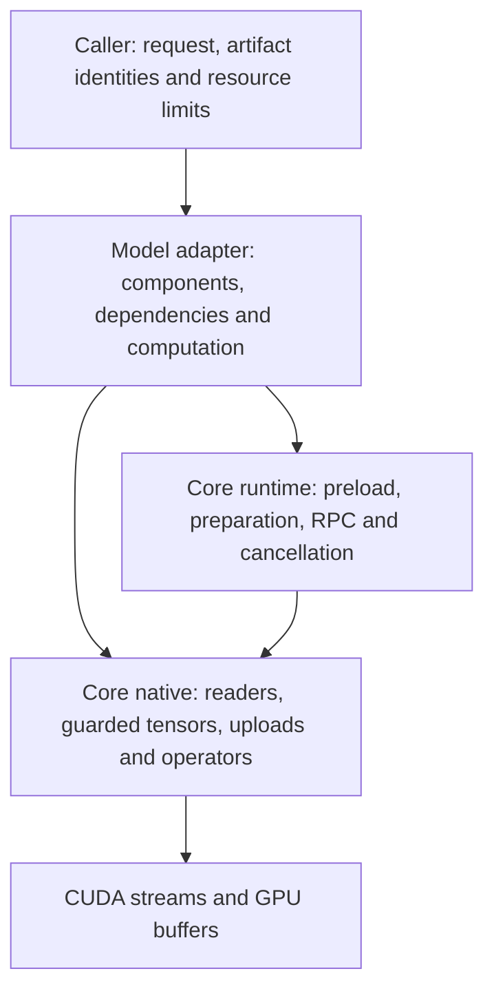
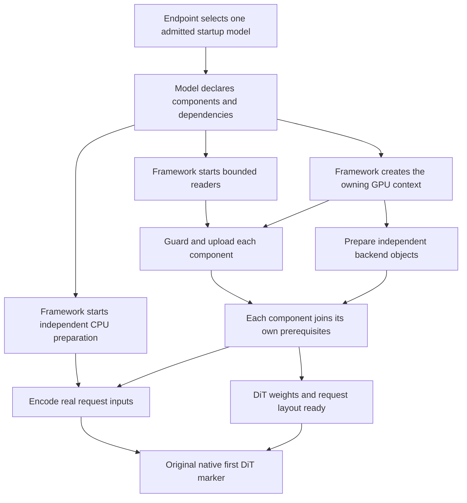
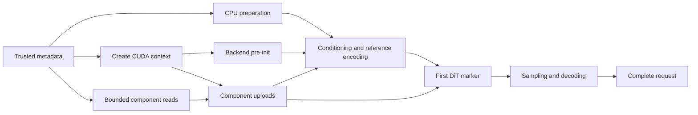

# Architecture and the model protocol

The model defines the computation. The framework supplies the mechanisms that
load its tensors, prepare its operators, manage their lifetime and serve requests.
A model migration connects both parts; porting only its forward pass is incomplete.

Dependencies point toward core. Core has no model names, workflow selection or
product recipes. Python transports requests and manages process owners; Rust
and CUDA execute model operations. Activations normally remain in GPU buffers
between operations. CPU submission does not imply an activation round trip to RAM.

## What each layer supplies

| Contract | Model or caller supplies | Framework supplies |
| --- | --- | --- |
| Artifact identity | Checkpoint manifest pin, source roots and admitted profiles | Metadata validation, range bounds and integrity policy |
| Components | Used tensor names, runtime dtypes and dependency groups | Bounded reads, allocation ownership and staged or independent uploads |
| CPU preparation | Tokenization, input preparation and immutable CPU assets | Owned preparation work, error propagation and joining |
| Backend pre-init | Shapes, layouts and the existing operator preparation hooks | Context binding, overlap, verified plan publication and compatible cache reuse |
| Model construction | Views that bind loaded tensors to the model's own tensor wrappers | Loaded device allocations, shapes, offsets and retained leases |
| Execution | Conditioning, model operations, sampler and decoder sequence | CUDA/operator primitives and process/RPC lifetime |
| Residency | Which weights may be evicted and when they are needed again | Bounded pinned storage, copy completion and cancellation mechanisms |
| Validation | Reference outputs, original required weight scope and supported requests | Timing/trace mechanisms and shared audit tools |

The framework does not infer a model graph or discover its dependencies from a
prompt. The adapter declares them. Tensor wrappers remain thin and model-specific;
this protocol does not require a universal Tensor API, autograd or CUDA Graph replay.

## The supported startup path

A maintained framework adapter follows this path:

**Select → admit declarations → start independent reads and initialization →
join each component at first use → encode the real inputs → real first DiT →
complete the request and required audit/cache work → cancel and join.**

The adapter declares facts: identities, tensors, resource limits, shapes,
prerequisites and numerical functions. The shared implementation owns scheduling,
read/upload completion, preparation lifetime and cancellation. A new model must
not reimplement these policies with detached threads, a separate reader pool,
manual cache-helper stop signals or an endpoint-specific loader. If a required
optimization is missing, add it to the applicable shared mechanism and validate
its existing adopters before connecting the model.

This is one responsibility contract, with several supported loader forms. It
does not require converting immutable archives into another checkpoint format,
or making a native single-process loader use Python component processes.
Historical and low-level diagnostic utilities are separate from maintained
model entries. They cannot silently satisfy migration acceptance.

| Decision | Required owner and rule |
| --- | --- |
| Which model starts | Service selection chooses one admitted declaration; unrelated model warmup cannot gate it |
| Which tensors load | Model declares the original required scope; framework admits identities and aggregate resource bounds before launching readers |
| When work starts | Framework releases work at declared prerequisites; CPU/context preparation must not wait for all weights |
| When a component is used | The maintained adapter joins its own load and required preparation; a socket or weight-only receipt cannot grant execution readiness |
| When preparation is reused | Execution verifies request geometry and identities, then consumes preparation on its actual owner; a second build is an integration gap |
| When cache read-ahead stops | Shared loader owns the handoff, including later deferred stages; model code does not stop another stage's helper early |
| What may overlap | Model declares real data/order/memory constraints; framework owns bounded work and joins; independent operations still require numerical and memory validation |
| When teardown is complete | Consumers stop before producers or leases retire; prove whole child exit and join workers, then report completion |

Code enforces admission, budgets and the state transitions implemented by each
shared API. Performance cannot be guaranteed by declaration syntax: native
receipts and matched original-request measurements must also prove that the
maintained entry point used the intended path. Keep these two gates separate.
The dated per-model records list paths that still lack acceptance; this contract
does not promote them by documentation alone.

The contract has four rules: the model declares work and dependencies; core
schedules the work; unmet requirements reject execution; normal entry points
consume the same model declaration. Historical comparisons use frozen source.

The complete native executor is Rust
[`declared_startup::DeclaredStartup`](../core_infra/src/declared_startup.rs).
It owns admission, the bounded work queue, dependency release, request scopes,
result state, cancellation and consumer checks. Native models bind numerical
functions with `Bindings`; process-based model adapters use the thin Python
[`DeclaredStartup`](../core_infra/runtime/declared_startup.py) binding to that
same executor. The Python reference implementation exists only in CPU tests.
The model supplies
`Component` and immutable `Preparation` declarations. Each component explicitly
lists required preparation IDs and a load validator. Each required preparation
supplies its consumers, inputs, initialization function and receipt validator.
Admission rejects missing work, mismatched consumers or invalid dependencies
before starting loads. Only exact `True` validation grants readiness.

A preparation may declare a CPU function and the weights required by its GPU
initializer. Core starts CPU preparation beside IO, then releases GPU work after
both prerequisites. A waiting dependency occupies no executor worker. A real
consumer/memory dependency may defer that initializer until use; the same
executor handles it. Models do not start tasks or join loader/preparation futures.

Normal entries call `before_use`, `check_before_use` or `invoke`. A native process
adapter uses Rust `declared_startup_gate::StartupGate` to reach that same gate.
The native server waits on executor notifications rather than a Python polling
loop. Request admission can call a bound host function once to normalize facts;
consumer readiness does not round-trip to a Python checker. An omitted
request, failure, cancellation or rejected receipt cannot become a success or an
implicit fallback. `ready(name)` describes weights only; `preload_ready` also
requires static initialization. Neither establishes request-specific readiness.

Direct actors and already-resident actors are transports of this same policy.
For residents, the existing process-tree owner still retires the actual GPU
process; closing a borrowed RPC port does not cancel CUDA work. A registered
shared component uses core's dependency projection of the full model declaration,
not a handwritten partial startup routine.

A declared aggregate reader-buffer limit is required. CPU/RAM allocation remains
with the caller/endpoint and the acceptance record. If that allocation is also
included as declaration metadata, both values must be explicit and valid; core
does not invent them or infer a full-model memory fit from a buffer budget.

Native CPU-only preparation uses `CpuPreparation`; results declared as required
must pass `finish_validated`. This ownership primitive alone does not supply a
complete model startup graph or detect an omitted registration. A native model
migration must also provide and execute that full required-work contract.

## The startup protocol

The startup contract applies to a standalone model as well as a multi-model endpoint.
The endpoint may select one admitted `startup_model` before a request arrives.
Without that selection, the first real request selects the model. The model
declares the same component plan in either case; the endpoint does not implement
a second loader. The service adapter defines the admitted selection labels and
supported device counts. Core operates on those declarations without adding
model names or deployment-specific selection rules.

Selection starts two independent tracks as early as their declared inputs allow:

* **Weights:** bounded reads, guarded byte ranges, host staging and device upload.
* **Initialization:** CPU assets, the owning GPU context and independent backend
  or layout preparation. Request-dependent work waits for an admitted request
  or a declared profile.

Use a dependency graph to specify prerequisites. Use a separate timeline to show
when work actually runs. Diagram position is not a timing measurement. A component
constructor joins its own prerequisites; it is not an all-model readiness barrier.
GPU upload may overlap later reads after its first chunks and context are ready.

This graph is a template. Model declarations supply additional real dependencies,
including memory and request-shape constraints. An output decoder must be ready
before its first use, but is not inherently a prerequisite of the first DiT.
Other models' optional host warmup is service policy and cannot gate the selected
model's cold start. Do not invent a dummy request to mark execution preparation
complete. Receipts list request preparation that is still outstanding.

1. **Admit metadata.** Offline preparation records the tensor ranges, dtypes and
   hashes of the original files. The serving caller supplies a trusted declaration.
   A declaration carries paths and identities, not copied weight payloads.
2. **Start independent work.** Start bounded readers and CPU preparation before
   creating the CUDA context. Declare CPU assets and backend pre-init as part of
   the adapter; do not leave them behind a full-weight-load barrier.
3. **Release GPU work on a live context.** Call the applicable `device_ready`
   hook once the owning context is current. Backend preparation and independent
   component uploads can then overlap file reads.
4. **Join at actual dependencies.** An encoder may execute when its own weights
   and preparation are ready. It need not wait for the DiT. Join every component
   required by the original request before its first use.
5. **Execute the real request.** Conditioning supplies the DiT inputs; the sampler
   and decoders produce outputs. Structural preparation and cached backend plans
   do not run a dummy generation or substitute recorded activations.
6. **Complete and retain safely.** A retained-RAM cache must not add a second
   full-file read before first DiT. If the session promises later reloads, finish
   that cache before returning the first request. Audit light-checked weights
   through the service's post-request audit policy.
7. **Cancel and join before teardown.** Stop readers and preparation workers,
   complete or retire outstanding copy ownership, and join workers before their
   CUDA context or host leases can disappear. Stopping a Python proxy alone does
   not establish that native GPU work has stopped.

   A successful signal or a zombie process leader is not proof that its worker
   threads have exited. For a child, a completed `wait`/`waitpid` establishes
   exit; Linux cross-owner cutoff harnesses can bind a pidfd before signalling
   and require its exit event. Keep one bounded teardown deadline, preserve
   the primary error, and fail lifecycle acceptance if consumer exit cannot be
   proved. Force-retiring the explicitly owned test environment is a cleanup
   fallback, not a successful consumer-before-producer receipt.

Edges indicate dependencies, not a requirement to serialize all initialization.
Backend hooks must preserve the model's existing operator layouts and numerical
choices. A failed or incompatible plan cache uses the native builder.
This fallback concerns operator cache entries. A supplied plan bundle with an
invalid identity fails admission; do not silently accept untrusted plan bytes.

Declare preparation separately from the tensor list: CPU-only work,
context-bound work that needs no weights, and constructors that need one loaded
component. Do not place the first two behind an all-weights barrier. Join a
constructor at its own dependency. If an adapter deliberately keeps an ordered
stage, explain the ordering or memory constraint. Additional operations needed
at first use must be named and timed instead of hidden under a general ready flag.

Multi-model scheduling is a separate layer. First-request selection must not
wait for unrelated models. Optional host prewarm and optional registration need
separate gates: reads may use a permitted compute window, while registration may
need to wait for idle. Foreground requests pause optional work at bounded chunks
and reuse its completed bytes and guards; they must not wait for a full prewarm.
Core supplies safe pause/takeover mechanisms. The endpoint declares priority and
which compute/idle windows permit them. Single-model adapters need not implement
a multi-model routing policy.

An explicit copy-prefetch command may promise that all declared uploads are
complete before it returns. Joining all copies is then part of that command's
contract, not evidence of an unnecessary inference barrier. Keep that receipt
honest. The normal generation path can still join components at their actual use.

## Two native loading forms, one responsibility boundary

For published checkpoints, `checkpoint::Source { manifest, sha256, roots }`
loads a validated `Declaration`. `runtime.service.checkpoint_environment`
forwards the same fields as `NATIVE_CHECKPOINT_MANIFEST`,
`NATIVE_CHECKPOINT_SHA256` and `NATIVE_CHECKPOINT_ROOTS`. Use the declaration
in the maintained CLI, service or ABI entry point, not just a benchmark wrapper.

`model_load::start_components` gives independent components one bounded reader
pool and separate uploads. `start_staged` preserves an ordered load schedule.
`startup::Preparation` owns CPU work followed by context-bound backend work;
`startup_policy::CpuPreparation` handles CPU-only preparation. Models supply the
tensor lists and hooks; core owns the threads and their cleanup.

H3 also supports its existing prepared raw artifacts and trusted guard manifest.
Its model adapter declares process commands and complete preparation through
`runtime.declared_startup.DeclaredStartup`. Owned and resident ports use that
same executor. CPU metadata overlaps reads; its GPU initializer waits for the
declared weights. Dependent jobs occupy no worker while waiting. This does not
convert H3 artifacts or give service entries a separate scheduling policy.

## Readiness has several meanings

| Boundary | What it establishes | What it does not establish |
| --- | --- | --- |
| Socket ready | Commands can reach a resident owner | Weights are in VRAM |
| Weight-copy complete | The declared tensors have completed their uploads | Every execution workspace or backend object exists |
| Backend prepared | The declared shapes/layouts have compatible execution plans | A generation has run or every component is ready |
| First DiT | Required weights and conditioning reached the request's DiT boundary | Video decoding or the complete request has finished |
| Request complete | The requested outputs and required cache finalization finished | Acceptance of other shapes, models or recipes |

Measure container-user-code-entry-to-first-DiT separately from platform allocation,
image boot and complete-request latency. Capture the start at the first executable
user-module instructions, before framework/model imports and any preload or init.
Include `@enter`, admission and all initialization. Retain the remote module PID,
function-entry stamp and native marker PID to reject a serialized local clock.
This consolidation compares each fixed single-B200 case with its previously
established route-specific cold-start baseline, with no performance regression.
The earlier uniform 8-second optimization target is not this round's gate.
Dual-GPU work is paused; its previous performance remains the baseline. A function-body clock is useful
diagnostic evidence but does not establish this acceptance boundary.

Use the original native stream marker;
do not add a device-wide synchronization to make a timing probe convenient.
Already-pinned RAM-to-VRAM copy timing is a separate measurement from file IO,
registration and dtype conversion. Actual source bytes and dependency work,
rather than parameter-count labels, explain expected startup cost.

A copy receipt must identify its scope and required preparation. In the standard
native adapter, `gpu_prepare_required` declares work included in the admitted
copy/preparation plan; `gpu_prepare_complete` means that declared work completed.
When no preparation was declared, a true completion flag does not mean all model
execution objects are ready. Record the actual prepared components and any
remaining lazy initialization. Do not manufacture readiness by renaming flags.

A preparation future completing only proves that its declared callback returned.
If the callback reports `prepared=false` or defers a shape, retain that scope in
the receipt; do not label it backend-ready. A maintained fast-profile adapter
must validate the native reply and prove execution reused that preparation on
the actual owner. Unknown shapes may take an explicitly reported native fallback,
but that fallback does not establish fast-profile migration acceptance.

Admission distinguishes retained RAM, pinned RAM, VRAM weight payload, prepared
objects and full execution scratch. Shared views and registrations count once
against their physical owner. State whether a worker limit applies to one cohort,
one process or the container; summing per-component pools must not silently raise
the requested resource budget. File-I/O policy also belongs to the selected
loader: the same environment variable need not imply the same cache strategy in
a different adapter.

Host receipts must distinguish actual retained weight storage
(`host_resident_bytes`) from its registered subset (`host_pinned_bytes`), with
`0 <= pinned <= resident <= declared bound`. Count each physical allocation
once, including aligned padding and reader-private or queued retained slabs;
this is weight-storage accounting, not process RSS. An older receipt without
the resident field uses its validated pinned count as the compatibility value.
Status reads metadata only: it must not wait for an idle-registration gate,
register memory, or acquire a payload lease whose final drop could free CUDA
resources on the reporting thread.

A reusable GPU context or a partial RAM receipt does not establish complete
host readiness. Reserve the remaining primary host bound independently of
context readiness, and charge auxiliaries separately. A receipt claiming
registered host readiness requires the declared validated ranges and actual
registrations on every required rank. A CPU-read-complete receipt states its
remaining registration work; execution-object readiness is also separate.
Completed unregistered ranges retained on takeover must be able to resume idle
registration without rereading their payloads. Propagate optional read, pin and
cancellation gates to every worker that performs that preparation, including
secondary-device workers. Scope inherited policy to the relevant load or
command so it cannot leak into later foreground work.

## Core implementation map

| Path under `core_infra/` | Responsibility |
| --- | --- |
| `src/checkpoint.rs`, `runtime/checkpoint.py` | Trusted in-place checkpoint metadata and offline preparation |
| `src/model_load.rs`, `src/weight_loader.rs` | Bounded readers, light/full guards, device allocations and component uploads |
| `src/startup.rs`, `src/startup_policy.rs` | CPU/context preparation and owned joins |
| `src/device_context.rs`, `src/pinned_weights.rs` | Context identity, pinned leases and copy ownership |
| `runtime/components.py`, `runtime/service.py` | Process declarations, readiness, RPC and lifecycle |
| `runtime/checkpoint_prefetch.py`, `runtime/plans.py` | Optional OS cache helpers and verified backend-plan publication |
| `src/execution_start.rs`, `src/startup_trace.rs` | Native execution markers and opt-in traces |
| `kernels/` | Generic native operators and backend plans |

## Retained host work and archive callbacks

Immutable serving archives can use `resident_weights::HostArchive::load_cohort`
and owner-thread preparation callbacks. The framework owns their bounded reads,
trusted guards and retained storage; the model declares component constructors.
This is a separate artifact form from the declared-checkpoint component loader.

Shared readers can retain guarded ranges and reservations for foreground takeover.
Host registration has chunk checkpoints, and H2D copies stay within registration
boundaries while retaining their sources. Optional reads and registration have
separate permission gates. The caller defines compute/idle scheduling; core does
not select models. Existing defaults remain explicit per adapter.

Before `Components::device_ready`, `device_started()` is false and a host-warm
caller can use `finish_host(retained_budget)` to adopt that same CPU read schedule.
The framework drains all component consumers concurrently into immutable aligned
storage, preserving the queued bytes, open files and original integrity checks.
It admits the complete retained payload plus the existing shared reader budget
before allocation. This host-only command makes one bounded CPU copy from each
reusable chunk; it does not reopen or reread checkpoints. `finish_host_unpinned`
does no CUDA work, while `finish_host` registers the finished pages on the calling
owner's current context. Once uploads have started, host takeover is rejected;
callers can inspect the state before consuming their pending load. This does not
change the ordinary cold-inference schedule or its buffer policy.

Each model documents its adapter in an `architecture.md` or `README.md` beside its sources:
[MiniMax H3](../models/minimax_h3_official/README.md), [Wan 2.1](../models/wan2.1/architecture.md)
and [LTX 2.5](../models/ltx25/architecture.md).
