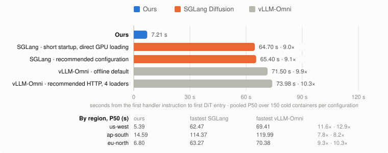
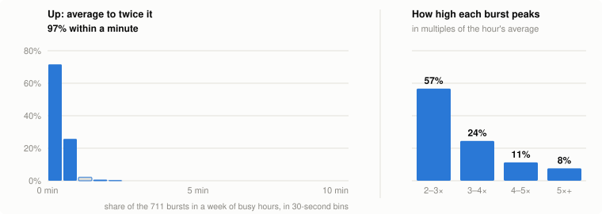
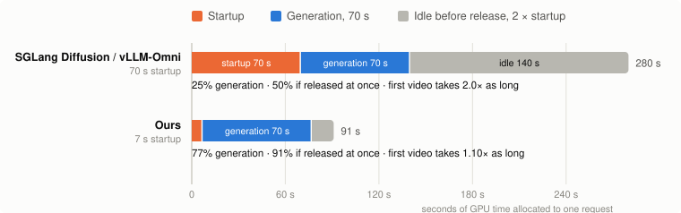
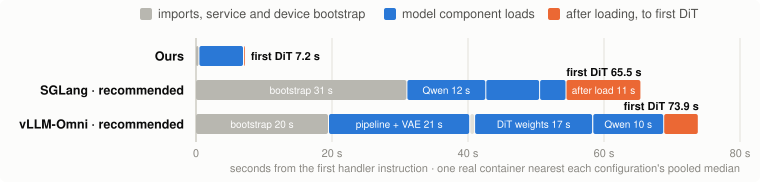
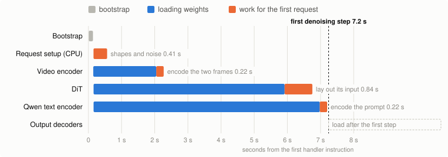

# How We Made Video Model Cold Starts 10× Faster and Halved GPU Time

*Seven seconds to the first denoising step on a fresh B200, against 65 to 75 for SGLang Diffusion and vLLM-Omni. On our production traffic, that cuts idle GPU time by 84%.*

| Result | | Detail |
| ---: | --- | --- |
| **≈10×** | faster cold start | 7.21 s to the first denoising step, against 64.70 s for SGLang Diffusion and 71.50 s for vLLM-Omni; median of 150 cold B200 containers each |
| **84%** | less idle GPU time | time spent starting up or kept idle, replaying our production traffic with a 70-second and a 7.2-second startup; the same work needs 44% of the GPU time |

<picture>
  <source media="(prefers-color-scheme: dark)" srcset="images/blog-cold-start-study-dark.svg">
  
</picture>

**Figure 1. A cold container reaches its first denoising step in 7.2 seconds; SGLang Diffusion and vLLM-Omni take 65 to 74.** Median over 150 cold containers per configuration on one B200, 50 in each of three Modal regions; ratios are to our median, and the lower rows give each region's median. For each engine, its fastest configuration and its recommended one; the other five (72.14 to 75.00 s) are in Appendix A, with what each configuration name means, the workload, the clock and the P90s.

A video model's cold start decides two things: how long the first user in a burst waits, and how much GPU time you pay for that produces nothing. We rebuilt our video inference framework in Rust, and on it a fresh MiniMax H3 container reaches its first denoising step at a median of 7.21 seconds on one B200, and in about the same time on two. With the same workload on one B200, the fastest SGLang Diffusion and vLLM-Omni configurations we tested take 64.70 and 71.50 seconds, 9.0× and 9.9× as long, across 1,500 cold containers in three regions.[^1] This post explains why that matters, where the minute goes, and what we changed. The source is at [github.com/creatify-ai/native-video-inference](https://github.com/creatify-ai/native-video-inference), under a source-available community license.

## Why startup time matters

### A video request holds a whole GPU for a minute

LLM serving assumes that a burst becomes a bigger batch. The assumption holds because decoding is memory-bound: each step reads the weights once for the whole batch, so another sequence costs little, and the compute left idle is where new prompts get processed. The machinery is built around this: continuous batching admits new requests into a running batch, chunked prefill slices long prompts into that spare compute alongside ongoing decodes, and a paged KV cache fits more sequences into the same memory. A hundred GPUs serving an LLM handle thousands of conversations at once, and when a burst arrives, every reply slows a little. The extra wait is usually seconds, far shorter than a new server takes to start, so startup is paid once and amortized, and cold start has been a lower priority.

Video generation has no such slack. A diffusion request behaves like one enormous prefill, redone at every denoising step: compute-bound almost from start to finish, with no idle phase for another request to ride along in. It holds at least a whole GPU for a minute or more, and batching several gains little. A hundred GPUs generate at most a hundred videos; the hundred-and-first waits up to a full generation for a GPU to free up, or for a new one to start. When the alternative to a cold start is a minute in the queue, how fast a GPU comes up decides how long users wait.

Video generation bursts are common: as fal puts it, a feature launch or a viral template can multiply demand within minutes.[^2] Our own traffic looks the same. Over a week of busy hours, the per-minute request rate crossed twice the hourly average about nine times an hour, typically peaking near three times it, and nearly one burst in five reached four times. At the extreme, the busiest minute of that week brought more than twenty times the requests of a typical minute. Figure 2 shows how fast those bursts rose, and how high they peaked.

<picture>
  <source media="(prefers-color-scheme: dark)" srcset="images/blog-cold-start-bursts-dark.svg">
  
</picture>

**Figure 2. Each request needs a whole GPU, so the GPUs needed rise and fall with requests. In a week of our busy hours, the request rate passed twice the hour's average about nine times an hour, and 97% of those bursts got there within a minute.** The request rate is the number of requests that arrived in the past minute, taken every second. A burst starts when it passes twice the hour's average; up is the time since it was last at or below the average. On the right, how high each burst peaked, in multiples of the hour's average (median 2.8×).

### Waiting users or idle GPUs

A fixed number of GPUs cannot absorb these bursts. Size the fleet for the hour's average, and requests queue behind generations of a minute or more: once every GPU is busy, the next wave of requests waits up to 70 seconds, the wave after it up to 140, the one after that up to 210. Latency climbs with every wave in line, and a burst that lasts still needs more GPUs, so the cold start comes anyway, on top of the wait. Size the fleet for the peak, and the GPUs wait for requests instead: at three to four times the average, they sit idle most of the hour. Few companies will keep hundreds of B200s running around the clock for bursts that last minutes, and when a thousand requests arrive together, few have a thousand GPUs warmed up and waiting.

The way out is to grow the fleet with the burst, but a slow startup brings both costs back. The first user in a burst waits through it, and the GPUs kept warm to avoid it sit idle. Figure 3 puts numbers on one cycle. Take a 70-second generation, roughly what a 28-step H3 request takes on two B200s.[^3] Because a restart is expensive, a worker is kept for a while after its last request; the rule of thumb we used ourselves keeps it idle for twice its startup time. With a 70-second startup, that is 140 seconds of idle, and of the 280 seconds the GPU is allocated, 25% is generation. Releasing the worker the moment the video finishes only lifts that to 50%. The first user also waits through the startup, so the first video takes 2.0× as long as a warm one. With a 7-second startup, the same cycle is 77% generation, 91% with no idle time at all, and the first video takes 1.10× as long.

<picture>
  <source media="(prefers-color-scheme: dark)" srcset="images/blog-cold-start-cycle-dark.svg">
  
</picture>

**Figure 3. Startup, and the idle time it forces, decide how much of a GPU's time is generation.** One request on one worker: startup, a 70-second generation (note 3), then idle retention of twice the startup time before release. Platform scheduling excluded.

One request per worker is the worst case; in real traffic a worker kept warm often catches the next request. Replaying our own production traffic with a 70-second and a 7.2-second startup, each kept idle for twice its startup, still moves the share of GPU time spent generating from 33% to 75%: the time GPUs spend starting up or sitting idle falls by 84%, and the same work needs 56% less GPU time.[^4]

For video generation, then, GPU efficiency also depends on how fast a fleet can follow demand: how quickly a new worker starts when a burst arrives, and how soon an idle one is released after it passes. The two are linked. A worker that takes a minute to start has to be kept for minutes after its last request, because releasing it early means paying that minute again on the next burst. A worker that starts in seconds can be released almost at once. Our principle is that a worker should be cheap enough to start that GPUs can follow demand instead of waiting for it.

## Where the minute goes

In our cold-start study, ten configurations of the same MiniMax H3 workload each ran in 50 cold containers in each of three Modal regions, timed from the first instruction of our handler. The container is not the slow part: on Modal or fal, a new B200 container is running code within seconds.[^5] The nine SGLang Diffusion and vLLM-Omni configurations, the maintainers' recommended startup settings among them, reached the first denoising step at medians between 64.70 and 75.00 seconds, and close to two minutes at the 90th percentile. Both teams are actively improving startup and loading; these numbers are for the versions pinned in Appendix A.

The hardware does not explain that minute. A PCIe Gen5 x16 link moves roughly 60 GB/s in each direction, so even the 66 GB of H3's DiT checkpoint crosses from host memory in about a second, less when it is split across two B200s. A Modal container reads 11 to 22 GB/s from its region's warm cache, so even the 133 GB of the DiT and text encoder checkpoints is a read of six to twelve seconds. Startup should take seconds. The rest of the minute is software.

Figure 4 shows where it goes, in one real container near the median of ours and of each engine's recommended configuration.

<picture>
  <source media="(prefers-color-scheme: dark)" srcset="images/blog-cold-start-breakdown-dark.svg">
  
</picture>

**Figure 4. The Python engines spend 20 to 31 seconds before reading a weight, then load components one after another; ours loads them all at once and prepares the first request's inputs alongside.** One real container nearest each configuration's median (SGLang Diffusion recommended, vLLM-Omni recommended with 4 loaders) on a shared axis. Single containers from different regions, not averages. Our loads run in parallel and overlap the first request's preparation, which leaves 0.1 s after the last load; Figure 5 shows those steps in another container.

| One container near each median | SGLang Diffusion | vLLM-Omni | Ours |
| --- | --- | --- | --- |
| Before the first weight is read | 31 s | 20 s | 0.5 s |
| Loading the model components | 23 s, one after another | 49 s, one after another | 6.6 s, in parallel |
| After loading, to the first denoising step | 11 s | 5 s | 0.1 s |
| **First denoising step** | **65.5 s** | **73.9 s** | **7.2 s** |

The Python engines spend most of their minute before and between loads: imports, service startup and device initialization come first, then the components load one after another, and vLLM-Omni's pipeline construction alone, with its VAEs, takes 21 seconds. Once everything is loaded, the first request still waits while its inputs are decoded, the text encoder runs, the frames are encoded and the DiT's input is laid out; ours starts that work while the weights are still loading, leaving 0.1 s after the last one lands. This is the LLM assumption at work. For a server that starts once and runs for days, thirty seconds of imports, a sequential load and a slow first request hardly matter. A video worker that starts with every burst pays them every time, and every one of those seconds sits between the user and the first frame.

## What we changed

We rewrote the framework around the opposite assumption: a worker starts often and has to be useful within seconds. Three changes follow from it.

**A much smaller bootstrap.** Our framework is written in Rust and compiled before release, so unlike a PyTorch engine it has no machine-learning framework to import at startup; the Python engines in Figure 4 spend 20 to 31 seconds importing and initializing before they read a weight. The only Python left is a thin orchestration layer that uses the standard library alone. Our CUDA kernels are built for the B200 ahead of time, and the kernels we inherited from Triton, SGLang's sparse-attention router among them, ship as precompiled binaries checked by SHA-256, so nothing is compiled just in time. The first weight read begins within half a second of the handler starting.

**Everything that can overlap does.** Startup is a dependency graph, not a script. Components that do not depend on each other start loading together: in Figure 5 the text encoder, the DiT and the video encoder all start within the first 0.2 seconds. File reads start before the CUDA context exists, so creating it, often a second or more per component, hides behind I/O. Read buffers are registered with CUDA directly, so chunked reads stream into asynchronous uploads without a staging copy.[^6] While the weights are still arriving, the request's inputs are processed and its cuDNN plans are loaded, or built if no prepared plan matches its shape. Decoders that are needed only to produce the output video load while the denoising steps run, which take minutes, instead of before the first one. The Python engines load their VAEs before the first step, so our clock counts those seconds against them; deferring would help them too.

<picture>
  <source media="(prefers-color-scheme: dark)" srcset="images/blog-cold-start-steps-dark.svg">
  
</picture>

**Figure 5. Each piece of the first request's work starts as soon as what it needs has loaded.** One of 30 cold containers from a profiling run on 29 October, with a later build than the study and tracing on (one B200, us-west): the one nearest the study's 7.21-second median, at 7.24 s (this run's median: 7.74 s). Load bars include setup, reads, allocation and upload. The two frames are encoded while the DiT and the text encoder are still loading, the DiT's input is laid out while the text encoder is still loading, and the prompt is encoded as soon as the text encoder lands. The run stopped each container at its first step and none had loaded an output decoder; their lane shows where they load, not a timing.

**Work done once, not on every start.** Anything that can be known before a request arrives is computed before deployment, and a worker reads only what inference uses. Weights are repacked from the official checkpoint: the text encoder stops at the layer H3 conditions on, and the DiT's AdaLN projections, 26 of its 66 GB, become small modulation tables for the timesteps of the deployed step schedule, so a worker reads about 95 GB where the checkpoint's DiT and text encoder alone are 133. The router kernels are compiled, and cuDNN plans are prepared for the shapes our traffic has used over the past few months, keyed to the exact shape, GPU and library versions, so a worker reads bytes it can use as they are. In our test this preparation took about 70 s, once per deployment: about what each Python engine spends on every cold start.[^7]

Starting fast does not make inference slower. Nothing on our path compiles, tunes or caches on first use, so the first request in a fresh process runs within 0.03% of the speed of a warm one. Warm, an H3 request on the same B200 runs at least as fast as on SGLang Diffusion and vLLM-Omni (1.5% and 0.8% less time), and its output matches SGLang Diffusion's bit for bit.[^8]

None of this is free. A general framework serves dozens of models from one codebase; we port each model by hand into native code, and the port is most of the work. So far that covers MiniMax H3, LTX 2.5 and two Wan 2.1-based models, and the same loader brings the official Wan 2.1 I2V checkpoint to its first denoising step in a median 8.9 seconds.[^9] Precomputing also fixes choices: the modulation tables hold one step schedule, so changing the schedule means preparing again. For models that start with every burst, the trade has paid off for us.

## Owning the whole inference path

We did rewrite our inference engine in Rust, but the language is not what we set out to change. What we wanted most was to own our whole inference path, end to end. Our runtime owns it at fine grain: storage readers, host memory, PCIe transfers, the moment the CUDA context is created, GPU memory and CUDA streams. Each change above is a decision about one of those resources that a general-purpose framework usually makes for you.

That control lets us work from first principles. We expected startup to take seconds because we measured what the hardware allows: a Modal container reads 11 to 22 GB/s from its region's warm cache, so everything one of our workers reads takes four to nine seconds, and that read is the only real limit the hardware sets. Everything else on the path was software, and ours to change. Working this way has taught us more as we added features to our framework; those lessons are for follow-up posts, so stay tuned.

## Why we are opening it up

Making each generation run faster has drawn enormous effort from the community: FlashAttention, sparse attention, fused kernels, caching across denoising steps (TeaCache, EasyCache, First Block Cache), all aimed at getting more out of every GPU second. We build on that work and are grateful for it. As a field, we have made GPUs very efficient during inference; we should make them equally efficient between inferences. That is the other half of GPU efficiency, and it is where we hope to contribute back.

It matters beyond any one company's bill, because GPUs are scarce. A GPU kept idle for the next burst is one nobody else can use; a GPU released seconds after its last request goes back to the provider, where another team can run on it. So faster startup does more than save money: it lets the same scarce GPUs serve more of the people waiting for them. We have not measured how much capacity this frees, but it is where the incentives point.

We built this runtime because we needed it, and we are opening it up because the problem is not only ours: every team serving large video models with on-demand GPUs pays for slow startup in waiting users and idle GPUs, and we think every serving stack should start in seconds. The code is at [github.com/creatify-ai/native-video-inference](https://github.com/creatify-ai/native-video-inference), with Modal examples, so you can try the startup yourself; Appendix B says what to expect on a first run. Much of what we describe could live in SGLang Diffusion or vLLM-Omni too, and we would be glad to help bring it there. We have started with SGLang Diffusion: Appendix C says what we think carries over, what does not, and what a first branch does.

Looking ahead, we think the same approach reaches beyond video. As an early sign of that potential, we ported DeepSeek-V4 the same way: on a host that has read the weights, [DeepSeek-V4-Flash](../models/deepseek_v4_flash/README.md) reaches its first token 7 to 9 seconds after its process starts on one B300, and [DeepSeek-V4-Pro](../models/deepseek_v4_pro/README.md) in about 27 seconds on eight, some 20 to 60 times sooner than a stock SGLang server becomes ready, with outputs that match SGLang's bit for bit. LLM serving is not our focus and the Pro port has had no performance tuning, but it suggests that large language models could start in seconds too.

At that scale a slow start is a bill, and it decides how the GPUs can be bought at all. Eight B300s cost about $57 an hour on demand[^10], so a start of 19.8 minutes costs about $19 before the first token, and a five-minute job on top of it is 80% startup. Nobody rents that way: with starts of twenty to thirty minutes the only workable choice is to reserve the GPUs and keep them warm, used or not. At 27 seconds the same start costs about 42 cents, 8% of that five-minute job, and renting eight GPUs for five minutes becomes reasonable. That is what makes on-demand possible for models this large, and it lets a provider or a large cluster share the same GPUs across tenants by traffic and by time of day instead of leaving them reserved and idle. We would be glad to help the industry find that on-demand GPU time in the hardware it already has.

## Appendix A: How we measured

Startup benchmarks are easy to get wrong, so this is exactly what the study measured and what it did not. First, what the configuration names mean. Figure 1 shows each engine's fastest configuration and its recommended one; the table after the contract has all ten.

| Configuration | What it is |
| --- | --- |
| SGLang · short startup | SGLang Diffusion's speed performance mode, eager execution (no torch.compile), built-in warmup off, FSDP off, cuDNN attention |
| … direct GPU loading | SGLang's --direct-gpu-weight-loading option, off by default. It reads the unquantized DiT checkpoint straight into GPU memory instead of staging it in CPU memory first, at the cost of holding the checkpoint and the model weights in GPU memory together while loading; it requires a GPU-resident DiT. In this study it cut the short-startup median from 73.07 s to 64.70 s, SGLang's fastest configuration. It applies to the DiT only. |
| SGLang · recommended configuration | The startup settings SGLang's documentation recommends: speed preset, resident components, eager, platform attention, automatic encoder placement, direct GPU loading on, warmup off |
| SGLang · default HTTP server, warmup off | The HTTP server at its defaults, with only the built-in warmup turned off so that the first DiT forward belongs to the measured request |
| vLLM-Omni · offline default | The offline Python API at its defaults, for the FL2VA task on one GPU |
| vLLM-Omni · default HTTP server | The HTTP server at its defaults |
| vLLM-Omni · recommended HTTP, N loaders | The HTTP server as vLLM-Omni's H3 recipe recommends (FL2VA only, resident, eager, TRTLLM attention), with 4 or 16 parallel weight-loader threads |
| vLLM-Omni · offline eager, 16 loaders | The offline API in eager mode with 16 weight-loader threads |

| Control | Value |
| --- | --- |
| **Study** | Ten configurations × three Modal regions (us-west, ap-south and eu-north) × 50 cold containers, 1,500 containers, completed 21 October 2026 |
| **Ours** | Our runtime, FL2VA with parallel preloads; the build measured on 21 October 2026, which predates the public repository |
| **Workload** | MiniMax-H3 FL2VA, official Base BF16 weights (no Turbo or GRPO); MiniMaxAI/MiniMax-H3 revision 42ed227; 28-step recipe, 768 × 768, 124 frames, seed 0; one gradient input PNG and one prompt for every run; the first DiT forward is entered, never executed |
| **Hardware** | One NVIDIA B200 per container on Modal; 16 physical CPU cores and 192 GiB requested; host CPU model recorded, not pinned (placement below) |
| **SGLang Diffusion, pinned** | sgl-project/sglang 77ba54f plus two public kernel files from 961bcf4; four configurations: short startup with direct GPU weight loading on or off (performance mode speed, eager, warmup off, FSDP off, cuDNN attention, text encoder TORCH_SDPA, TF32 off); default HTTP server with only warmup off; recommended configuration (official speed, resident, eager presets, platform attention and encoder auto, documented opt-in direct GPU loading, warmup off) |
| **vLLM-Omni, pinned** | vllm-project/vllm-omni 83afc05; five configurations: offline Python API at defaults (model, class, trust_remote_code, task_type fl2va, one GPU); offline eager with 16 weight-loader threads; default HTTP server; recommended HTTP server (single FL2VA, resident, eager, TRTLLM attention) with 4 and with 16 parallel loader threads |
| **Clock starts** | First cloud-handler instruction in the container |
| **Clock stops** | CUDA-synchronized entry of the first DiT host forward, before it executes |
| **Clock includes** | File prefetch, imports and engine initialization, required weight reads and host-to-device transfers, input preprocessing, conditioning and encoding |
| **Clock excludes** | GPU allocation, queueing and machine boot, weight downloads, image build and compilation, offline weight preparation, DiT forward compute |
| **Not claimed** | That any configuration is the engine's global optimum; the recommended configurations follow published startup guidance without a parameter search. Region and CPU differences are observational |

All ten configurations, seconds from the first handler instruction to the first DiT entry. Pooled columns cover 150 cold containers each; the regional columns are the median over 50.

| Configuration | P50 | P90 | us-west P50 | ap-south P50 | eu-north P50 |
| --- | ---: | ---: | ---: | ---: | ---: |
| Ours | **7.21** | 19.88 | 5.39 | 14.59 | 6.80 |
| SGLang: short startup, direct GPU loading on | **64.70** | 119.31 | 62.47 | 114.37 | 63.27 |
| SGLang: recommended configuration | **65.40** | 121.16 | 62.54 | 113.97 | 63.63 |
| vLLM-Omni: offline default | **71.50** | 126.03 | 69.41 | 119.99 | 70.38 |
| vLLM-Omni: offline eager, 16 loaders | **72.14** | 122.54 | 69.72 | 118.63 | 71.09 |
| SGLang: short startup, direct GPU loading off | **73.07** | 140.37 | 71.35 | 131.50 | 70.06 |
| vLLM-Omni: default HTTP server | **73.68** | 126.57 | 71.28 | 118.28 | 72.27 |
| vLLM-Omni: recommended HTTP, 4 loaders | **73.98** | 124.11 | 70.97 | 118.84 | 72.65 |
| vLLM-Omni: recommended HTTP, 16 loaders | **74.52** | 125.70 | 71.85 | 118.93 | 73.32 |
| SGLang: default HTTP server, warmup off | **75.00** | 140.67 | 70.96 | 135.17 | 72.09 |

The region selector does not fix the host CPU. ap-south placed every container on Intel Xeon 8559C hosts and was slower for every configuration; us-west and eu-north were mostly AMD EPYC 9575F. The pooled figures weight the three regions equally, so the regional columns are the controlled view.

## Appendix B: The platform underneath

The body of this post treats the platform's own startup as a few seconds. That depends on the provider, and it is the first thing to check if you reproduce our numbers. We measured four B200 platforms on 19 and 20 October 2026, and today only two of them, Modal and fal, start a new serverless container in seconds. Together AI copies the weight volume to each new node first, and Nebius boots a new virtual machine for every job, so there the platform alone takes from tens of seconds to minutes.

| Platform | A new container starts in | Weight reads in a new container | What limits a cold start |
| --- | --- | --- | --- |
| Modal | 2 to 9 s, 36 s at 30 containers | 0.5 to 2.3 GB/s cold; 11 to 22 GB/s on AMD hosts after one earlier read in the region | The first read in a region; GPU capacity by region and hour |
| fal | 3 to 15 s with the image on the host, about 60 s more for an image pull | 1.0 to 3.0 GB/s cold; 2.7 to 6.6 GB/s on a new host after an earlier read | A smaller cache effect |
| Together AI | 16 to 90 s, including a copy of the volume to the node | 13 to 62 GB/s from that local copy | Each new node copies the volume again |
| Nebius | 2 to 6 minutes: a new virtual machine per job | 8.4 to 9.6 GB/s, cold or warm | The machine boot |

No runtime can hide that layer: the seven seconds in this post need a platform that starts the container itself in seconds, and we leave that layer to the platforms. In production, the platform's own scheduling also sets the tail of the wait for a new container.

**Reproducing seven seconds.** Use Modal: it is where we ran the study, and the repository's examples target it. Our study did not clear caches, so it measures regions whose cache already held the weights. On Modal, the first read of a new volume in a region is cold, at 0.5 to 2.3 GB/s, so your first containers can take one to three minutes to read a full worker's weights; later containers read from the warm cache. Run several containers rather than one: our median was 7.21 s and our 90th percentile 19.88 s, and hosts with Intel Xeon 8559C CPUs were slower than AMD EPYC 9575F hosts for every engine we tested.

## Appendix C: Bringing this to SGLang Diffusion

SGLang Diffusion is close to our H3 work: our runtime runs its sparse-attention router kernels, and its output is the reference ours matches bit for bit. So it is the first place we want to bring this work, and we have tried the ideas of this post on a branch of SGLang Diffusion's main, serving MiniMax H3 on one B200.

On 5 November 2026 we ran both versions on Modal in us-west, 50 containers each in the same round, timed from the serving handler's entry to the first DiT forward. On fast hosts, main reached the first denoising step at a median of 79.0 seconds and the branch at 20.1. On the two slower kinds of host, the medians fell from 152.9 to 31.9 seconds and from 161.6 to 42.8. Full 28-step runs produce identical frames, and a denoising step still takes 1.29 seconds. This is a newer main and a separate round from the study in Appendix A, so its numbers are not comparable with Figure 1.

| What we do in our runtime | In SGLang Diffusion |
| --- | --- |
| Weights are read while everything else starts | Doable: on our branch, helper processes that do not import torch read the checkpoint into the page cache or GPU memory while the worker imports, all 128.8 GB by 14 seconds |
| Pinned reads stream into GPU uploads | Doable: on our branch, the text encoder and VAE load straight to the GPU through a pinned 16-thread reader |
| Nothing compiles on first use | Mostly doable: on our branch, JIT, Triton and CuTe caches built into the image take the first request from 12.8 to 1.25 seconds. The caches are tied to the image and the GPU |
| A small bootstrap | Partly doable: on our branch, the worker starts while the launcher is still resolving arguments, bytecode ships in the image and optional imports wait until they are used. Importing torch and the runtime still takes 12 seconds |
| Reading only what inference uses | Partly doable: on our branch, prefetch skips the text encoder's layers past the one H3 uses. SGLang's AdaLN cache option could skip the 26 GB of AdaLN projections for a fixed step schedule; not tried yet |
| Output decoders load after the first step | Doable, but worth little: the video VAE loads in 0.4 seconds on our branch |
| No collective setup on one GPU | Doable: on our branch, distributed setup drops from 0.65 to 0.16 seconds |
| Components load in parallel | Hard in one Python process: the GIL and process-wide loading state get in the way, so our branch moves the reading into other processes instead |
| The first request is prepared while weights load | Hard: the server takes requests only once it is ready, and pipeline stages run in order. On our branch only 1.25 seconds are left there |

Three things we tried on the branch did not help: direct I/O (buffered reads already reach 16 to 17 GB/s), creating the CUDA context earlier (it is already cheap there) and replaying the file reads of an earlier start.

We would like to offer this upstream as small pull requests and a cookbook page: the new startup features off by default behind flags, each change with its own same-round measurement, and no change to the numerics. The [proposal](sglang-cold-start-proposal.md) has the per-phase numbers, the pull requests we have in mind and the questions we would like the maintainers to answer first. It is a proposal, not a finished patch set. If the SGLang team wants it, we would be glad to contribute it and to shape it the way they want the code to look, and we would be just as glad to help the vLLM-Omni team.

## Notes

[^1]: MiniMax H3 FL2VA (MiniMaxAI/MiniMax-H3 revision 42ed227, official Base BF16 weights), 28-step recipe, 768 × 768, 124 frames, one B200 per container; ten configurations × three Modal regions × 50 cold containers, completed 21 October 2026. The clock runs from the first instruction of the cloud handler to the entry of the first DiT forward, before it computes: it includes imports, engine initialization, weight reads and uploads, and input encoding, and excludes GPU allocation, queueing, machine boot, downloads, image builds and offline weight preparation. Ratios compare our median with the fastest configuration of each engine. The full contract and all ten configurations are in Appendix A. We also measured two-B200 containers, in fewer runs; they reach the first denoising step in about the same time.

[^2]: DeepSeek's [inference system overview](https://github.com/deepseek-ai/open-infra-index/blob/main/202502OpenSourceWeek/day_6_one_more_thing_deepseekV3R1_inference_system_overview.md) reports, for 27 to 28 February 2025, an average decode output of about 14,800 tokens per second per H800 node of eight GPUs and an average output speed of 20 to 22 tokens per second per user. Dividing one by the other gives about 670 to 740 sequences in flight per node, 84 to 93 per GPU, or eight to nine thousand per hundred GPUs. This counts decode only; DeepSeek runs prefill on separate nodes. A different model on different hardware, used only for the order of magnitude. On batching video, vLLM-Omni's published MiniMax H3 recipe reports four step-batched requests finishing in 182.1 s, against 174.8 s served one after another, for its own configuration on two H100s: a third-party measurement of a different setup, cited only to show that batching gains for large video DiTs have a different shape than for LLM decode. Smaller or offload-heavy diffusion workloads can still benefit from batching. The quotation is from fal's [guide to generative-media inference](https://fal.ai/learn/serverless/ai-inference-provider-for-generative-media) (13 October 2026).

[^3]: A round 70 s is an example of generation length, not a measurement. A longer generation narrows the gap and a shorter one widens it: at the roughly 155 s the request in note 8 takes on one B200, generation is 42% of the cycle with a 70-second startup and 88% with a 7-second one.

[^4]: A replay of our production requests on Modal, each with its arrival time and measured processing time. Every simulated worker is one GPU serving one request at a time, provisioned on demand without a cap, and each model keeps its own pool; startup and idle retention are the only variables. Platform scheduling is not modeled: every new container takes exactly the stated startup, while in production the slowest few percent of requests also wait for the platform to schedule one (Appendix B). GPU time is compared with the 70-second case. Modeled allocation, not billing.

[^5]: From the request to the first line of our code in the container, measured on 19 and 20 October 2026: Modal 2 to 9 s, 36 s at 30 containers; fal 3 to 15 s with the image on the host, about 60 s more for an image pull. Other platforms, and what they mean for startup, are in Appendix B.

[^6]: The reads are checked. Each prepared file is hashed in full once, when it is prepared; before use, each tensor's first and last kilobyte are compared with a manifest whose own SHA-256 is pinned. The framework can also hash every byte again in the background after the first request. Neither SGLang Diffusion nor vLLM-Omni, at the versions in Appendix A, nor the official MiniMax H3 code hashes the weights when loading them, so this check is extra work, not a shortcut.

[^7]: One run on 20 October 2026 in a container built from the public Dockerfile, with the official checkpoint already downloaded. Starting from an empty native model directory, the default validation command extracted and converted the tensors, generated the tables, compiled the router kernels, prepared the cuDNN plans and ran a fresh-process probe to the first DiT entry in 69.7 s, 3.5 s of it the probe. It excludes the weight download and the image build.

[^8]: 22 October 2026: H3 FL2VA, 1376 × 768, 124 frames, one B200 per container. Ten GPUs each ran our runtime, SGLang Diffusion and vLLM-Omni in balanced order with matching cuDNN attention, two warm-up requests and one measured request of 49 model evaluations, timed end to end from input processing to the saved MP4: 154.7 s against 157.0 s and 156.0 s. CUDA graphs and torch.compile were off in every engine, so this compares the engines without them. Ours was faster in every pair, and its sampler output matched SGLang's bit for bit. Cold against warm compares the denoising stage of the first request in a fresh process (30 runs) with the third request (10 runs): 151.62 s against 151.58 s. One request shape, not a workload.

[^9]: Official Wan 2.1 I2V-14B weights in BF16, ten cold containers on one B200 with 16 vCPUs, from function entry to the start of the first DiT forward: median 8.9 s, P90 18.0 s. Allocation and image pull are excluded.

[^10]: Modal's list price on 11 November 2026: $0.001972 per second per B300, so $0.0158 per second for eight, $56.8 an hour. 19.8 minutes (1,188 s, a stock SGLang server from launch to ready on a host that had not cached the weights) is $18.74; 26.5 s is $0.42; five minutes of work is $4.73. GPU price only: CPU and memory are extra, the queue for GPUs and the container start are not counted, and both starts are longer on a host that has not read the weights (the native one took 212 s there).
