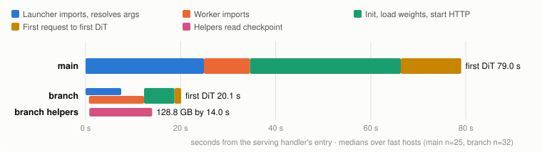

# SGLang Diffusion cold start: a proposal

*Proposal · SGLang Diffusion · MiniMax-H3 on 1×B200. Work in progress on a branch of SGLang main,
not yet split into PRs. Part of the [cold-start post](blog-cold-start.md#appendix-c-bringing-this-to-sglang-diffusion).*

## Getting to the first DiT step in 20 s instead of 79 s

A fresh MiniMax-H3 server on main needs 79 s on a fast host, and 150 to 160 s on a slow one, before
its first DiT forward. Very little of that is GPU work. The launcher finishes importing and
resolving arguments before the worker starts. The worker then reads 129 GB of weights one component
at a time. The first request JIT-compiles kernels. Our branch overlaps these steps, keeps compiled
artifacts in the image, and produces identical frames. We would like to upstream it as 13 small PRs
plus a cookbook change.

| Hosts | main | branch | |
| --- | ---: | ---: | --- |
| Fast hosts | 79.0 s | **20.1 s** | 3.9× sooner · 25 vs 32 runs |
| Slow hosts, type 1 | 152.9 s | **31.9 s** | 4.8× sooner |
| Slow hosts, type 2 | 161.6 s | **42.8 s** | 3.8× sooner |

Median time from the serving handler's entry to the first DiT forward. 50 runs per arm, both arms
in the same round on Modal us-west, FL2VA 768×768, 124 frames, 28 steps, warmup off. Full 28-step
runs give identical framemd5 on both, and the steady step stays at 1.29 s.

## Where the 79 seconds go

On main every stage waits for the one before it. On the branch the worker starts at once and
imports while the launcher parses arguments, and helper processes read the checkpoint at the same
time. When the worker is ready it takes over weights that are already in memory.

<picture>
  <source media="(prefers-color-scheme: dark)" srcset="images/sglang-cold-start-timeline-dark.svg">
  
</picture>

To scale, medians over fast-host runs of the same round (main n=25, branch n=32). The branch's
helpers have all 128.8 GB in page cache or VRAM by 14.0 s. On slow hosts the shape is similar, but
imports and loads run about 1.8× slower.

| Phase (fast hosts) | main | branch | saved | What removes it |
| --- | ---: | ---: | ---: | --- |
| Worker ready to load (imports done) | 34.6 s | 12.3 s | 22.3 s | Worker prestart (#10) puts imports beside argument parsing. Bytecode in the image (#4) and import trims (#6–#9) shorten them. |
| Init, load weights, start HTTP | 31.7 s | 6.4 s | 25.3 s | Prefetch during imports (#11, #13). Direct-GPU loading for the text encoder (#12) and video VAE (#1). Concurrent header reads (#5). Single-rank dist init (#2). |
| &nbsp;&nbsp;of which loading 5 components | 29.2 s | 3.3 s | 25.9 s | Main: text encoder 8.7 s, DiT 15.6 s, video VAE 3.0 s |
| First request until first DiT | 12.8 s | 1.25 s | 11.6 s | JIT, Triton and CuTe caches built into the image (#14). The JIT cache fix (#3) keeps the cache valid when its root is a symlink. |
| **First DiT forward** | **79.0 s** | **20.1 s** | **58.9 s** | |

## Four changes

**Start the worker first (#10).** For single-node serving, the CLI spawns the worker as soon as it
starts, so the worker imports the runtime while the launcher resolves arguments. Afterwards the
launcher sends the resolved spec and any environment changes. Multi-node launch is unchanged.
*Launcher and worker imports now overlap.*

**Read weights while Python imports (#11 · #13).** Helper processes start without torch or
site-packages, so they compete with the worker's imports as little as possible; imports run about
1.18× slower while they read. They stream the checkpoint into the page cache, or into exportable
VRAM that the worker adopts by file descriptor. They read only the tensors the pipeline loads; each
pipeline config declares a filter for this. If the handoff fails, loading falls back to pinned
reads. *128.8 GB in place by 14.0 s, during imports.*

**Load straight to GPU (#12 · #1 · #5).** Text encoders gain direct-GPU loading with a 16-thread
pinned reader. The VAE fix makes the existing direct-GPU flag usable on H3; today it leaves
`inv_freq` on the meta device. Safetensors headers are read concurrently. *With prefetch: component
loads 29.2 → 3.3 s.*

**Stop repeating work in each container (#4 · #6–#9 · #2 · #3 · #14).** Ship `.pyc` files in the
Docker image; otherwise the first process compiles about 8,000 modules. Import optional features
only when they are used. Skip eager NCCL setup when there is only one rank. Keep kernel caches on
image disk, not on a network volume. *Bytecode ~8 s · first request 12.8 → 1.25 s.*

## Proposed PRs

Each PR changes one mechanism and comes with its own same-round on/off measurement. Fixes come
first because they are small and independent. The startup features are larger and can be turned on
and off with flags, so they need the longest review. In the evidence column, ✓ marks a number in
hand and ○ a single-change measurement still to run before the PR is opened.

**Independent fixes** (can go up in parallel)

| # | PR title | Owners | Behavior | Evidence so far |
| ---: | --- | --- | --- | --- |
| 1 | [Fix] diffusion/loader: Keep construction-time buffers when loading a VAE directly on GPU | diffusion | bug fix + regression test | ✓ correctness fix; VAE load 3.0 s on main, 0.4 s on branch |
| 2 | [Perf] diffusion: Skip eager NCCL communicator setup on a single rank | diffusion | always on | ✓ dist init 0.65 → 0.16 s |
| 3 | [Fix] kernels/jit: Drop staging files from dependencies when the cache root is a symlink | kernels | bug fix + regression test | ○ rebuild cost to measure |
| 4 | [Perf] docker: Ship Python bytecode in the final image layer | docker | image build, +65 s | ✓ worker imports 19.5 → 11.4 s |
| 5 | [Perf] diffusion/loader: Read safetensors headers concurrently | diffusion | always on | ○ to measure, expect < 1 s |

**Import trims** (measured with `-X importtime`, no GPU needed)

| # | PR title | Owners | Behavior | Evidence so far |
| ---: | --- | --- | --- | --- |
| 6 | [Perf] diffusion: Defer optional-feature imports off the worker startup path | diffusion, cache-dit | always on + sys.modules test | ○ to measure |
| 7 | [Perf] diffusion/registry: Resolve built-in pipeline configs without importing pipelines | diffusion | always on, follows SGLang #46043 | ○ to measure |
| 8 | [Perf] srt: Import quantization methods on first use | srt quantization, model_loader | always on + registry test | ○ to measure, dropped if < 0.3 s |
| 9 | [Perf] srt: Defer media-decoder and reasoning-parser imports | srt | always on | ○ to measure |

**Startup overlap** (behind flags, off by default, enabled by the H3 cookbook page)

| # | PR title | Owners | Behavior | Evidence so far |
| ---: | --- | --- | --- | --- |
| 10 | [Perf] diffusion: Start single-node workers before resolving server arguments | diffusion | RFC issue first | ○ on/off A/B to run |
| 11 | [Perf] diffusion/loader: Prefetch checkpoint files into the page cache during startup | diffusion | `--weight-prefetch` | ○ on/off A/B to run |
| 12 | [Feat] diffusion/loader: Support direct GPU weight loading for text encoders | diffusion | `--component-direct-gpu-weight-loading.text_encoder` | ○ on/off A/B to run; main TE load is 8.7 s |
| 13 | [Perf] diffusion/loader: Prefetch selected components straight into GPU memory | diffusion | `--weight-prefetch-device-components`; needs #11, #12 | ✓ first DiT 2.0 to 2.8 s sooner at equal bandwidth |

**Deployment** (no code)

| # | PR title | Owners | Behavior | Evidence so far |
| ---: | --- | --- | --- | --- |
| 14 | [Docs] cookbook: Build kernel caches into the MiniMax-H3 serving image | docs | cookbook page | ○ 12.8 → 1.25 s on the full branch; solo A/B to run |

## Ground rules we are following

- **Opt-in.** The new startup features are off by default, like srt's
  `--weight-loader-prefetch-checkpoints`. The MiniMax-H3 cookbook page turns them on, and it is
  updated in the same PR that changes the recommended deployment.
- **No change to numerics.** Every PR gets a full 28-step run against main: identical framemd5 and
  an unchanged steady step time.
- **Same-round evidence.** Volume bandwidth swings widely between hosts and rounds (the same files
  have read at 2 to 146 GB/s), so each A/B runs both arms side by side and compares them within one
  host class.
- **Repo conventions.** PR titles follow `[Type] scope: title` and tests meet the unit-test
  admission rules. The helpers use `NamedTuple` instead of `msgspec.Struct` because they run without
  site-packages, and each such type will say so in a comment.

## Where we would like your input

1. **Worker prestart (#10).** This is the largest structural change: the CLI forks the worker
   before `ServerArgs` exists. We plan to open an RFC issue before the PR. Is this direction
   acceptable to the diffusion owners?
2. **Flag names.** Should `--weight-prefetch` share a name, or code, with srt's
   `--weight-loader-prefetch-checkpoints`?
3. **Prefetch filters.** Each pipeline config would declare which tensors its loaders skip, so that
   prefetch reads only what loads. Is a pipeline-config field the right home for this?
4. **Kernel caches.** Should the official image prebuild JIT kernels for popular diffusion models,
   or should we only document it in the cookbook?

---

Measured 2026-11-05 on Modal: 1×B200, 16 CPU, 192 GiB, checkpoint `MiniMaxAI/MiniMax-H3@42ed227e`
on a network volume. A run is classed as a fast or slow host from an import probe run on the same
machine afterwards; the slow hosts fell into two types. PR numbers in this document (#1 to #14)
are the proposal's own, not issues of this repository or of SGLang.
