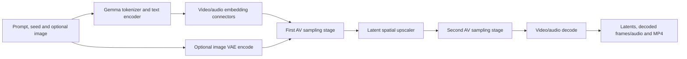

# LTX 2.5: model and framework architecture

LTX owns its exported computation, tensor wrappers and numerical operations.
The framework owns checkpoint reads, component uploads and preparation lifetime.
See the [common model protocol](../../docs/architecture.md).

## A request through LTX

`request.rs` composes the stages. `graph.rs` binds exported operation metadata
to native tensors and kernels; it does not discover a new model graph per request.
Recorded reference activations are never inputs; a prepared profile
([`prepare/`](prepare/__init__.py)) contains programs, model constants and metadata only. Intermediate model tensors stay in
GPU buffers. Latent-only profiles stop before decoding; media output requires
the audio and video decoder profiles.

## Checkpoint declaration

The runner passes a `{manifest, sha256, roots}` checkpoint declaration through
the three standard `NATIVE_CHECKPOINT_*` environment fields. The manifest
(`core_infra.runtime.checkpoint`) describes tensor ranges in the original
checkpoint files; it does not rewrite the weights or the profile.

The `infer` entry point, `Session::infer` and the native ABI require that
declaration. A missing declaration fails before a session starts; these routes
cannot silently select a full-file loader. Only `Session::run` with a reference
(non-exported) configuration keeps a full-SHA verification path.

## What LTX declares

`startup.rs` maps the checkpoint tensors into five load groups:

| Group | Purpose |
| --- | --- |
| `text.` | Gemma text encoder |
| DiT video/audio embedding connectors | Text-to-model conditioning |
| Remaining `dit.` tensors | AV transformer |
| `vae.` | Video VAE, including image encoding |
| `upscale.` | Latent spatial upscaler |

`model_load::start_components` serves these groups through one bounded reader
pool, with independent uploads. The model declares runtime dtypes; core keeps
allocation offsets, copy ownership and integrity checks.

Standalone, resident and ABI sessions bind those groups to Rust `DeclaredStartup` in
`declared.rs`. `NativeLoadPlan` owns reader/device resources and independent
upload progression. Declared preparations cover tokenizer CPU work, resident
weight restoration, processor attention layouts and installation of each real
weight group into LTX's cache. Owner-lane validators check actual cached tensors
and the installed tokenizer before computation.

Tokenizer CPU preparation starts before CUDA. Linear metadata is prepared by
the device binding; attention metadata runs while the first upload drains on a
core worker. `ConsumerGuard` spans text computation and its nested connector
consumer, then the sampling/VAE/upscaler phase. The request retains its original
numeric order and weight/activation lifetimes.

The native ABI binds `IndependentAtUse`: CPU readers and tokenizer work start
at initialization; the first tensor loader activates only when a declared
consumer needs it. Host warming can adopt the existing readers, and later
uploads reuse those retained sources without reopening the checkpoint. The
Session does not advance or join upload stages.

## Session and ABI lifetime

`Session` owns a private CUDA context, loaded checkpoint views and retained RAM.
Core background work must be joined before that context is destroyed.
`startup::install` adapts loaded device views into LTX's own `Tensor`/`Buffer`
ownership; model constructors do not reread each weight independently.

The native backend's `init` requires the same `checkpoint::Source`, either in
`init.checkpoint` or through all three standard environment fields. It may create
its private context and start bounded CPU reads; it defers model VRAM uploads
until a direct `start` or explicit `prefetch`. Explicit prefetch checks its
caller-supplied copy budget. Fresh direct starts use native allocation for
declared components, with no static full-execution scratch gate. Later reloads
keep an available-VRAM-minus-3-GiB copy budget. The session's
`device_admission` metadata reports these policies.

An explicit `warm` materializes host residency. It takes over the bounded CPU
reader pools started by `init`, preserving buffered bytes and range guards.
Core drains all five consumers concurrently under the same reader count and
an 80 GiB retained bound. It copies reusable chunks to final host leases without
reopening source weights, then pins those leases on the owner. If device uploads
have already started, `warm` rejects that CPU-only takeover and leaves the
pending load available to `infer`. Once a prior prefetch has consumed the
readers, an explicit `warm` can materialize its requested RAM cache.

LTX has two host-storage paths. Its `HostBudget` is used only by
`Checkpoint::pin` through the synchronous full-SHA `PinnedWeights::load` path,
which allocates pinned memory before reading. Framework retained leases are
counted separately, once per `Arc` identity, using each
`HostWeights::pinned_bytes()` registration count. Pending readers or unfinished
host-cache work are not reported as pinned. `host_pinned_bytes` is not a
process-wide RAM or RSS measurement.

`prefetch` makes the declared weights resident on device and joins every
declared upload. A caller that wants cold conditioning to overlap later uploads
uses `start` directly. A resident session prepares its retained RAM cache after
stage 0 and joins/registers it before decode. Later eviction/reload borrows
those verified sources.

The one-request CLI `infer` owner reuses GPU weights and immutable assets
through both sampling stages and complete decode, then exits. It does not
prepare a RAM cache for a later request; the report records
`host_cache_policy=request-lifetime`. `Session::infer` and the ABI keep
`resident-reuse`, including retained RAM, pinning and reload. Numerical inputs,
model tensors and operations are the same in both lifetimes.

## Two GPUs

`parallel.rs` runs DiT blocks 24-47 of every forward on GPU 1, on its own thread and private
context, and GPU 0 runs everything else. Block activations cross as peer copies of their whole
allocations (`device_context::copy_peer`), so each half runs exactly the one-GPU block graph.

The one-request `infer` leaves GPU 0's startup as it is with one GPU and starts GPU 1 once GPU
0's context is ready; creating both contexts at once delays GPU 0's first uploads. Once GPU 0's
DiT is installed, GPU 1 warms the profile with GPU 0's parsed gold profile (`gold::Shared`, about
40 ms) and copies its blocks from GPU 0's cache into one allocation of its own, so the checkpoint
is read once and GPU 1 touches no files while GPU 0 reads. The native ABI instead has each GPU
read its own half of the DiT (`second_partition`).

## Preparation boundaries

The model declares Gemma tokenizer preparation, text linear metadata and the
processor attention layouts. The prefetch receipt reports
`gpu_prepare_required=true` and completes only that declared preparation plus
the weight copies. Its `preparation` field reports the shapes/plans actually
prepared and `full_execution_prepared=false`.

Triton module loading, native convolution plans/workspaces, sampler buffers and
request activations keep their first-use lifetime. DiT uses compiled
native/CUTLASS operators; it has no model-wide graph compilation step.
No dummy inference is run.

The host-warm operation is synchronous and has no compute-window or
foreground-priority policy.

See [porting a model](../../docs/porting-a-model.md) and the
[cold-start rules](../../docs/fast-cold-start.md).
