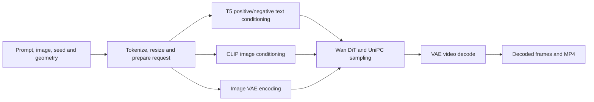

# Wan 2.1: model and framework architecture

Wan defines the I2V model computation, runtime dtypes and preparation hooks. Core supplies
checkpoint admission, loading, preparation scheduling and resident serving. See the
[common model protocol](../../docs/architecture.md) and the [model guide](README.md).

## A request through Wan

`pipeline.rs` supplies the explicit operation order. The model owns its noise, RoPE, image
preprocessing, sampling schedule and numerical layouts. GPU buffers carry activations between
native operations; Python does not execute a model forward or receive intermediate activations.

## Model declarations and core mechanisms

| Wan declaration | Shared mechanism |
| --- | --- |
| Offline manifest pin and `prepared`/`checkpoint` roots | `checkpoint::Source`/`Declaration` identity and range admission |
| `prepared_requests` tensor names and runtime dtypes | `model_load` allocation views and on-device dtype conversion |
| Stage 0: T5, CLIP visual and VAE; stage 1: DiT | `startup_native::NativeLoadPlan` binds the staged loader to Rust `DeclaredStartup` |
| CPU `front` closure and the attention-plan `prewarm` hook | Declared `request-backend` preparation, gated on the device |
| Encoder and DiT constructors and request scratch | Owner-lane `encoder-models` and `dit-model` preparations with result validators |
| Constructors from `DeviceWeights` | Borrowed views into core-owned `Loaded` allocations |
| `wan21-server` handler | `resident` command loop plus `NativeService` process and RPC ownership |

## Checkpoint admission

`admission.rs` connects the prepared CLI, the playground and the resident server to a trusted
declaration. `NATIVE_CHECKPOINT_MANIFEST`, `NATIVE_CHECKPOINT_SHA256` and `NATIVE_CHECKPOINT_ROOTS`
are the common serving input; `NativeService` sets them from its audit declaration. Without them,
the offline `WAN21_MANIFEST_SHA256` pin builds the same `checkpoint::Source`. There is no unpinned
fallback. The declared roots must match the directories that supply the tokenizer and frontend
assets. Admission reads metadata only and fails before CPU jobs, payload reads or CUDA work.

The manifest comes from [`prepare.py`](prepare.py). Its pin is fixed when the checkpoint is
prepared; a running service never derives trust from live weight or metadata bytes. The CLI keeps
full verification by default. Serving uses the trusted first/last-KiB guards before use, then
`NativeService` runs a low-priority full SHA-256 audit after the first request. The
converted-safetensors path (`--diagnostic-converted`) exists only for parity tooling.

## Cold startup

The resident server binds its socket before touching the GPU. On the first request, the CPU
frontend and bounded checkpoint reads start before the CUDA context. The tokenizer is loaded once
for both prompts, and its read is issued before image preprocessing. The context gate releases
backend preparation (attention plans). Encoder weights load first, and their computation overlaps
the streaming of the DiT stage. Core joins the remaining DiT weights before the DiT constructor and
first forward. `dit-model` depends on conditioning at use, so request scratch is allocated only
after the encoders finish. Later requests reuse the resident models.

Core owns readers, stage progression, upload handles and joins. The model declares its stages and
does not run a private worker pool or detached preload thread. `WAN_NO_PREWARM` is rejected by
presence, including an empty value or `0`, because backend preparation is required.
`NativeService` can also warm the OS file cache from the declared tensors. The staged loader hands
that helper's stop signal to the last deferred stage's first upload, so the encoder upload does not
stop read-ahead for the DiT.

The completed FP32 video is downloaded once into an aligned host vector. Its SHA-256 and the MP4
frame conversion borrow that data. RGB conversion splits complete frames across at most eight CPU
workers and keeps each element's FP32 operations and truncation. `ffmpeg` writes H.264 at 16 fps.

## Entry points

| Entry | Use |
| --- | --- |
| `wan21-generate` | One request from the command line; full verification |
| `wan21-server` | Resident process owned by `NativeService`; light guards plus the post-request audit |
| `serving.rs`, `backend.rs` | The standard native backend ABI for hosts that switch models on a GPU |
| `wan21-playground` | Parity rungs against recorded golds; see [porting a model](../../docs/porting-a-model.md) |
| [`examples/modal/wan21.py`](../../examples/modal/wan21.py) | Modal class over `NativeService` |

The backend ABI declares the T5, CLIP visual, VAE and DiT tensor inventories
(`preload_contract.rs`); T5, CLIP and VAE have priority 0, the DiT priority 1. After final sampling,
the session can retire T5, CLIP, the DiT and their scratch while the VAE decode continues, so a host
can start another model's uploads. VAE weights, latents and decoder caches stay. The free-memory
envelope from before retirement plus the framework margin bounds that overlap; unknown geometries
have no admitted overlap window.

An optional offline `WAN21_SERVER_SHA256` binds the server executable through
`NativeService.sha256`. The checkpoint pin alone does not certify the executable.

## Timing

`wan21-server` replies with `timing_schema: native-first-dit-v1` and a `first_dit_start` object. Its
`CLOCK_MONOTONIC` timestamp comes from a callback on the DiT's own CUDA stream, without an extra
device synchronization. Compare it only with monotonic boundaries, such as
`request_received_monotonic_ns` or a container entry time; the example's `first_dit_seconds` does.
The UNIX `marks` are diagnostics on another clock. `NATIVE_FIRST_DIT_TRACE=0` disables the marker.

Measure a cold start with every required weight upload and the T5, CLIP and VAE conditioning
inside the clock. Exact-output checks synchronize and read back tensors, so they belong in a
separate complete-generation run. A stored-checkpoint size change alone does not predict
first-DiT latency; see [fast cold start](../../docs/fast-cold-start.md).
